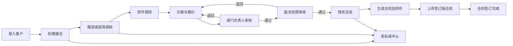
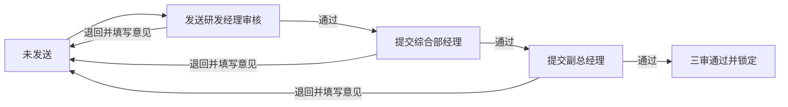

# Haihong Presales Hub 需求规格说明书

| 项目 | 内容 |
|---|---|
| 中文名称 | 海弘售前协同管理系统 |
| 英文名称 | Haihong Presales Hub |
| 文档版本 | v0.18 |
| 文档状态 | 开发基线 |
| 编制日期 | 2026-10-26 |

## 1. 项目背景

海弘目前有 5 名售前人员，客户信息、拜访跟踪、软件调研、报价、合同及岗位职责等资料分散在 Excel、HTML 和 Word 文件中。现建设一套仅供内部人员使用的售前协同管理系统，将客户从初次接洽到合同签订的过程集中管理，减少重复录入、遗漏跟进和文件版本不一致。

系统不面向客户、供应商或其他外部人员开放。

## 2. 已确认的建设原则

1. 系统初期以简单、稳定、易维护为主，不建设复杂的大型 CRM。
2. 现有客户信息 Excel、软件调研 HTML、报价 HTML、合同 Word 模板和岗位职责 HTML 均作为业务参考，不在代码仓库中保存真实客户数据。
3. 客户状态统一使用以下 7 项：
   - 初期接洽
   - 现场调研
   - 方案&报价
   - 报价完成&商务洽谈
   - 合同签订完成
   - 丢标
   - 中止
4. 报价审批流程为：研发经理审核后，提交综合部经理审核，再提交副总经理终审。
5. 合同正文条款使用固定模板，不提供正文条款编辑功能；合同附件根据客户实际情况编制。
6. 已签订合同不得被新版本覆盖，后续变化通过新附件或补充协议处理。
7. 报价和合同属于系统最高风险模块，必须以审批快照、版本锁定和金额一致性校验防止错用、漏审和版本混乱。
8. 2026-08-28 用户确认：重置密码后强制改密、领导指派事项无法完成时上报确认、待审报价随新负责人交接、客户来源/类型采用管理员维护字典。以下相应章节为新的开发基线；确认需求不等于功能已实现。
9. 2026-08-29 曾按原工作簿结构设计历史迁移边界；该方案已被 2026-10-19 的“不执行历史数据迁移、改为人员自行录入”确认结论替代，不再属于当前正式使用范围。
10. 2026-10-15 用户确认客户管理页聚焦查询和进入档案：客户列表不导出 Word，客户名称作为唯一档案入口，不再重复显示“查看档案”按钮；SOP 保留独立知识库入口，不在客户列表放置泛化快捷链接。
11. 2026-10-19 用户确认本系统不执行历史数据迁移，客户、跟进等业务记录均由有权限人员自行录入；“Excel 导入”从日常导航和正式使用范围移除。后续软件类型可能增加，调研模板由管理员在系统设置中按“草稿—发布—版本锁定”方式维护。

## 3. 建设目标

### 3.1 总体目标

建立统一的内部售前工作台，实现客户信息、跟进记录、提醒、调研、报价、合同和岗位职责的一体化管理，并保证各阶段数据能够连续引用。

### 3.2 具体目标

- 统一保存客户、联系人和项目需求信息。
- 记录每次电话、微信、现场拜访等跟进过程。
- 通过下一步行动和提醒时间，降低客户遗漏跟进的风险。
- 在地图上查看售前人员及客户的区域分布。
- 将现有软件调研页面纳入客户项目档案。
- 将调研结果、报价单和合同附件关联起来，减少重复录入。
- 对报价执行研发经理、综合部经理、副总经理三级审批，并保留每级审核人、审核时间、备注和版本记录。
- 固定合同正文，按客户项目生成可变附件。
- 将岗位职责和售前 SOP 作为系统内的查询资料。

## 4. 用户与权限

### 4.1 用户角色

| 角色 | 主要权限 |
|---|---|
| 售前人员 | 维护客户、联系人、跟进记录、提醒、调研、报价草稿和合同附件草稿 |
| 研发部经理 | 查看全部客户主档、联系人和报价，完成分派给本人的一级审核。其他管理操作按直属范围执行 |
| 综合部经理 | 查看全部客户主档、联系人和报价，完成二级审核。客户代录与管理操作按直属范围执行 |
| 副总经理 | 查看全部客户主档、联系人和报价，完成终审。提醒指派按审批关联范围执行 |
| 系统管理员 | 用户、基础数据、模板和系统参数维护；可由内部人员兼任 |

售前人员、研发经理、综合部经理和副总经理分别使用独立账号，不共用账号。审批记录必须关联到实际审批人的账号。

### 4.2 初期权限规则

- 售前人员只能查看和修改本人负责的客户及其联系人、跟进、调研、报价、合同和附件。
- 首期每名售前人员只关联一名当前部门负责人，不设置多负责人共同管理；负责人调整需要保留生效时间和历史记录。
- 未经转让或变更负责人，其他售前人员不能查看该客户信息。
- 客户转让或负责人变更后，新负责人获得客户完整资料权限，原负责人不再具有查看和修改权限。
- 系统保存转让前负责人、转让后负责人、操作人、时间和原因。
- 研发部经理、综合部经理和副总经理可浏览全公司的客户主档、联系人，以及报价草稿、在审单、审批历史和对应文件。完整模式下，直属范围外的客户展示基础档案和报价。
- 报价按研发部经理、综合部经理和副总经理顺序审核。“待我审批”依据当前审核环节和实际审核人筛选。客户写入、转让及调研、合同、导入等模块继续按各自的业务权限校验。
- 报价进入审批后，当前版本暂时锁定；退回后由编制人修改并重新提交。
- 审批人不能直接修改报价内容，只能通过或退回。
- 已审批报价、已生成合同和已签订合同均保留历史版本及操作记录。

## 5. 业务范围

### 5.1 本期范围

1. 登录与用户管理
2. 工作台
3. 客户及联系人管理
4. 客户跟进与拜访记录
5. 跟进提醒
6. 售前人员及客户分布地图
7. 软件调研
8. 报价及审批
9. 合同及附件管理
10. 岗位职责与售前 SOP
11. 文件归档、查询和基础导出
12. 操作日志与版本记录

### 5.2 暂不纳入本期

- 外部客户登录和客户门户
- 实时 GPS 定位或人员轨迹跟踪
- 电子签章
- 财务收款、发票和完整 ERP 功能
- 企业微信、短信等付费消息通道
- 自动生成复杂技术方案正文
- AI 自动决策或自动审批

系统为后续合同审批、电子签章和消息平台对接保留接口，但本期不实现。

## 6. 总体业务流程

客户状态可以由售前人员按业务进展调整；系统根据调研、报价审批和合同签订结果给出状态变更提示，但初期不强制自动变更，避免错误流转。

## 7. 功能需求

### 7.1 登录与用户管理

- 使用用户名和密码登录，仅允许系统管理员创建用户。
- 支持启用、停用用户及密码重置。
- 管理员重置密码时立即撤销旧会话，并标记“下次登录必须修改密码”。重置后的临时密码只允许进入本人改密及退出流程，在完成改密前服务端不得开放业务数据、下载或业务写入接口，不能只在页面提示。
- 用户完成改密后解除强制改密标记，撤销临时会话并重新建立有效登录状态。改密和重置只记录操作事实，不记录新旧密码、会话或凭据。
- 用户资料包括姓名、角色、手机号、邮箱、所属区域、常驻城市和头像；本人手机号和邮箱为新建报价的必填前置资料，并自动带入报价单底部“报价人”信息。
- 停用用户后，其历史客户、记录和审批信息仍然保留。
- 用户密码不得以明文保存或写入代码仓库。

### 7.2 工作台

工作台用于展示本人当前需要处理的事项：

- 今日及未来 7 天跟进提醒，包括本人创建和领导指派的事项
- 已逾期提醒
- 本人负责的客户数量及状态分布
- 最近跟进的客户
- 待本人处理的报价审批
- 被退回的报价
- 快速入口：新增客户、新增跟进、开始调研、创建报价

初期以清晰的待办列表为主，不堆叠过多图表。

### 7.3 客户管理

#### 7.3.1 客户基本信息

| 字段 | 说明 |
|---|---|
| 客户名称 | 必填；支持简称和全称 |
| 客户来源 | 销售推荐、展会、网络、老客户推荐等，可配置 |
| 客户类型 | 新客户、老客户等，可配置 |
| 登记时间 | 默认当前日期，可修改 |
| 客户状态 | 使用已确认的 7 项状态 |
| 客户需求 | MES、线束 MES、注塑 MES、PLM 等简要需求 |
| 行业 | 客户所属行业 |
| 所在区域 | 省、市、区县 |
| 详细地址 | 用于拜访及地图定位 |
| 地图位置 | 原图人工选点保存图片百分比坐标及底图摘要；已有经纬度保留，不按任意图片边界推算 |
| 客户情况总结 | 对客户背景和机会情况的综合说明 |
| 备注 | 其他说明 |
| 负责人 | 当前负责的售前人员 |
| 协同人员 | 可选，多人共同参与时使用 |

客户来源与客户类型字典由系统管理员新增、维护、启用和停用，不由普通业务用户修改。正常新增或更改取值只能选择启用项；已有客户引用的停用值可以原样保留，不能因停用而阻止编辑其他字段。已使用选项不得物理删除，不得改写历史导入原值或审计快照。

新增客户表单中，简称为选填；客户全称、负责人、登记时间、客户阶段、来源、类型、行业、省份、城市及客户需求均为必填。售前新增时负责人自动归属登录本人；管理员或有创建权限的经理代录时，选择其有权分配的售前负责人。既有客户资料不自动改写。

历史迁移保留文件原始文本，自动汇总来源/类型已有值及使用情况供管理员确认，不擅自合并相似词或把未知值静默映射成其他选项。未知值不丢失，作为待确认字典候选；候选汇总只对管理员开放，不借此展示其他售前的客户信息。

#### 7.3.2 联系人信息

- 一个客户可以建立多个联系人。
- 联系人字段包括姓名、部门、职务、手机、微信、邮箱、决策角色和备注。
- 联系方式只在内部系统中使用，不进入公开代码仓库或演示数据。

#### 7.3.3 客户列表

- 支持按名称、负责人、状态、来源、行业、区域和登记时间查询。
- 支持表格视图和按状态分组的看板视图。
- 支持导出当前筛选结果；导出操作记入日志。
- 支持从已确认的 Excel 模板批量导入，导入前提供预览和重复客户提示。

#### 7.3.4 客户详情页

客户详情页采用一个主档案加多个页签：

1. 概览
2. 联系人
3. 跟进记录
4. 提醒
5. 软件调研
6. 报价
7. 合同
8. 附件与操作日志

### 7.4 跟进与拜访记录

- 跟进方式包括电话、微信、现场、会议、邮件和其他。
- 每条记录保存跟进时间、参与人员、联系人、沟通内容、客户反馈、下一步行动、记录人和附件。
- 现场拜访可记录计划时间、实际时间、拜访地址、参与人员和拜访结果。
- 客户详情按时间倒序展示完整跟进时间线。
- 历史跟进记录原则上不直接删除；确需纠正时保留修改记录。
- 新增跟进时可同时设置下一次提醒。

### 7.5 跟进提醒

- 提醒关联客户，可选关联具体联系人、调研、报价或合同。
- 提醒来源包括本人创建和领导指派。
- 部门负责人及以上领导可以直接向售前人员指派提醒事项。
- 字段包括提醒时间、提醒事项、优先级、负责人、来源、指派人和备注。
- 状态包括待处理、已完成、已取消、已逾期，以及“无法完成、待指派人确认”。已逾期仍由待处理事项与原到期时间推导，不覆盖历史时间。
- 到期提醒在工作台显示，右上角铃铛作为唯一的统一提醒入口；左侧主导航不再单独设置“跟进提醒”，避免入口和内容重复。
- 点击铃铛打开统一提醒面板，可查看待处理、已逾期和最近完成的提醒，并可进入关联客户或业务记录。
- 提醒关联不能扩大业务对象权限：候选查询、直接创建、详情和历史读取采用同一对象权限；副总不能通过已知联系人、跟进或调研 ID 获取本来无权查看的内容。
- 本人创建的提醒支持完成、延期和取消；延期时保存原提醒时间。
- 领导指派的提醒由被指派人完成；延期或无法完成时必须填写原因，系统保留指派人、处理人和处理时间。
- 指派人可以查看所指派事项的完成、延期和逾期状态。
- 领导指派事项无法完成时，被指派人必须填写原因，进入“无法完成、待指派人确认”，不能自行标为完成或取消。指派人的统一铃铛中可查看并处理待确认事项；工作台只展示摘要，不增加重复菜单。
- 指派人可说明原因后确认关闭（保存为已取消）、恢复执行或重新指派，保留原内容、原到期时间、各次原因、操作人、时间与前后状态。该处理不代替报价或合同审批。
- 重新指派继续遵守现有客户权限：提醒承接人必须是客户当前负责人，指派人须有当前指派权限。需要换客户负责人时走原客户转让流程，不能借提醒重新指派向其他售前开放客户资料；原指派人失去权限时不能越权处理，沿用既有管理员管理权限。
- 本期先实现系统内提醒，企业微信、短信和邮件作为后续扩展。

### 7.6 分布地图

- 使用中国地图作为底图，展示省级行政区域、每名售前人员的负责区域及客户分布点。
- 中国地图数据和必要资源随系统部署在内网服务器，不依赖外网地图页面。
- 当前内网版本使用用户于 2026-10-19 提供的省级行政区 GeoJSON 作为业务分布示意资源，固定摘要为 `99adfeded5223848bbe37a0a12f8023e11ee12161c7800521c27db42fdeac275`。资源包含 34 个具名省级行政区和 1 个附加要素，但未携带来源地址、审图号或坐标系声明；页面必须明确标注“内网业务示意”，不得称为自然资源部标准地图。
- 客户已登记有效经纬度时可按数值绘制小型位置点；没有经纬度但有省份时只计入省份客户数量，不绘制容易被误解为精确地址的估算点；省份中心只用于放置聚合数量标签。省份缺失或无法匹配时列入“暂未定位”，不得伪造坐标，所有可视化结果均不改变客户主数据。
- 正式底图使用自然资源部标准地图服务提供的带审图号标准地图，并在页面保留审图号。底图作为本地静态资源原样使用，不裁切、不修改国界和行政区界；客户点位、人员颜色和负责区域说明使用独立业务图层叠加。
- 可按售前人员、客户状态和区域筛选。
- 地图默认以省份客户聚合为主：省份直接显示当前权限和筛选范围内的客户数量，并按数量深浅着色；右侧显示省份客户排行、涉及省份数和推进中客户数。点击省份必须展示客户名称、城市、阶段、负责人和最近跟进，并可带着省份条件进入客户管理，支持出差前集中筛选和拜访安排。
- 地图筛选采用即时生效，不再设置独立“应用筛选”按钮；客户阶段始终可选，售前筛选仅在当前角色可见多人时出现，省份通过地图或排行直接下钻。并发选择只允许最后一次筛选结果更新页面。
- 点击客户点位显示客户名称、状态、负责人、最近跟进时间和详情入口。
- 点击负责区域显示售前人员姓名、区域范围和区域内客户数量。
- 本期不采集实时定位，不记录人员行动轨迹。
- 客户地址无法准确解析时，允许人工选点修正。
- 原图人工选点使用 0—100 图片百分比坐标并绑定该原图 SHA-256，不把任意 PNG/JPEG 当作等距经纬度地图。底图变更后旧点显示待重新确认，不自动投影或迁移；数据响应、图片响应和选点提交都须匹配同一摘要，否则停止叠加并提示刷新。
- 人员负责区域独立于客户数量展示：管理员看到启用售前，部门负责人看到启用直属售前，售前看到本人；无客户不应导致该人员消失。副总仍限已有审批客户范围，不借地图扩大人员或客户权限。
- 地图不改变客户隔离规则：普通售前只能看到本人当前负责客户，售前之间不互相开放客户明细；部门负责人看到直属售前，管理员看到全部，副总经理只看到终审相关客户。跨售前联合拜访由部门负责人或管理员在现有客户转让、提醒和协同流程中安排，不以地图公开全部客户替代授权。
- 区域定位只能使用与当前原图核对过的配置锚点；无可靠锚点的区域保留文字说明，不以随机点、哈希点或未经确认的中心位置代替。
- 上一条的原图锚点限制适用于带审图号的 JPG/PNG 标准地图人工选点模式；用户提供的 GeoJSON 业务示意模式可以使用其自带的省级 `centroid`/`center` 作为明确的省级估算位置，但必须保留估算标识且不写回客户经纬度。

### 7.7 软件调研

- 将现有软件调研 HTML 的问题结构纳入系统，保持原调研内容和分组逻辑。
- 当前 MES 调研模板的正式口径为“6 个问答模块 + 4 张专项清单”，不是“7 大模块”：6 个问答模块共 49 个问题，分别为高层及项目负责人、IT / 信息化、工艺部门、计划 / 生产管理、设备 / 模具、质量管理；4 张专项清单分别为设备对接清单、MES 工位清单、第三方系统对接清单和定制化需求。
- 调研必须关联客户，可选关联具体项目。
- 支持草稿保存、继续填写、完成确认和复制历史调研。
- 保存每个问题的答案和说明；不设置逐题附件，只保留调研整体附件并支持权限化在线查看与下载。
- 支持多人补充，但需记录最后修改人和修改时间。
- 已确认的调研结果可以作为报价和合同附件编制依据。
- 已完成确认的调研不得原地覆盖；继续修改时必须填写修改原因并生成新版本，新版本状态回到草稿，原确认版本保持只读。新版本再次完成确认后，才能导出不带草稿标识的正式调研报告并供后续报价、合同引用。
- 支持将调研报告导出为可编辑的 Word 文件。
- 管理员可新建空白调研模板，或复制已有模板为新版本；草稿可编辑问题模块、问题、必填规则、专项清单、字段类型和下拉选项。
- 模板发布前必须通过完整性校验；发布后不可原地覆盖，后续修改必须复制为新版本。历史调研始终关联创建时使用的原模板版本。

### 7.8 报价管理

#### 7.8.1 报价编制

2026-11-03 确认：日常新报价通过下载标准 Word 模板、在本地填写后上传的方式制作；网页“创建报价”入口隐藏，旧代码及历史报价保留以便回滚和继续处理。下载模板沿用旧报价网页的空白模板，填写时替换中文占位内容，无优惠时删除优惠行。以下早期网页编辑规则保留供历史报价参考。

2026-11-09 最新确认：正式报价仅上传 PDF，取消上传 Word 源文件，历史文件及审批记录保留；报价单的 Word 导出关闭，标准 Word 模板下载保留。报价筛选仅提供全部状态、未发送、待我审批和审核通过四项，不再单独设置勾选框。

- 报价人在正式报价单内直接输入或选择有权限的客户名称；页面不再要求理解或选择“项目机会”。系统仍在后台建立客户和项目的内部关联，供权限、合同和历史追溯使用。
- 报价单抬头的联系人和手机属于客户信息，均为选填，由售前人员在报价单内自行填写；报价单底部“报价人”的姓名、手机和邮箱取当前登录账号资料，缺少手机或邮箱时先维护本人资料。
- 报价编号在保存时由服务端自动生成，页面只读；已有编号和审批历史保持不变。客户尚无档案时，先新增客户，再返回已填写的报价继续保存。
- 可引用客户需求及已完成的软件调研。
- 报价明细支持标准模块、定制化需求、接口对接、实施部署、设备对接和需求调研等分类。
- 明细字段包括项目、子项、单位、数量、未税单价、税率、未税金额、含税金额和备注。
- 项目费用明细创建时默认显示一行；单位字段在页面、查看页及 Word 中保持可见。
- 自动计算小计、合计和最终优惠价，并校验金额。
- 已填写项目费用明细时，其含税合计必须与项目总价的优惠前含税合计一致，否则不能保存或发送审批；未填写明细仍可暂不提供。历史未发送报价不自动改写，须纠正不一致后才能保存或送审。
- 金额按元显示两位小数和千分位；编辑时允许输入普通数字。总价表和费用明细表含税总额相同且税率一致时，因逐行反算四舍五入产生的尾差在明细表单列调整；金额不同或税率不一致时不强行对齐。已发送的旧报价沿用原有快照口径。
- 不需要优惠时不显示“优惠后合计”；需要优惠时由经办人展开设置，报价查看和 Word 按实际优惠情况显示。
- 支持从历史报价复制后生成新版本。
- 支持按照现有报价页面导出为可编辑的 Word 文件，本期不提供 Excel 导出。
- 创建报价时即可选择附件；新增及替换报价原文件和报价附件只接受 Word（DOCX），PDF、Excel、旧版 DOC 等格式不支持，上传后在报价单下方展示内容，保存后也可下载原件。在线预览保留 Word 段落、表格及常见图片，以及历史 Excel 工作表、合并单元格等内容，但不保证复杂排版与原文件完全一致。发送审批前可继续增删或替换，发送时与报价内容一起形成审批依据。

#### 7.8.2 报价状态

1. 未发送
2. 待研发部经理审核
3. 研发部经理退回
4. 待综合部经理审核
5. 综合部经理退回
6. 待副总经理审核
7. 副总经理退回
8. 审核通过
9. 已作废

#### 7.8.3 审批规则

- 每次提交形成一个明确版本。
- 审批人直接选择通过或退回；通过时备注默认为“通过”且可修改，退回时必须填写原因。
- 系统保存提交人、每级实际审核人、审核时间、审核备注、结果和版本号，并在报价详情中按顺序展示。历史报价入口位于备注后的操作列。长备注单行省略，鼠标悬停、键盘聚焦或手机轻触时以浮层展示全文。
- 报价查看页与创建、编辑页使用同一张正式报价单版式；查看页保持只读，并在报价单外展示当前及历史版本的实际审批记录，不展示无业务意义的固定流程占位。
- 售前人员直属综合部经理，综合部经理按直属关系查看客户并承担报价二审；研发经理是独立的报价一级审核角色，不作为售前直属领导。
- 系统必须且只能配置一名当前启用的研发经理处理一级审批；缺失或出现多名时禁止提交或审批，不能悄悄改交综合部经理或副总经理绕过一级审批。研发经理账号调整后，服务端按当前唯一启用账号重新校验待办，不能用调整前已打开的页面继续审批。
- 交接不修改已提交报价快照、金额、版本及历史意见；已进入综合部经理审核、副总经理终审或已审批完成的版本不重新打开一级审批，也不改写实际历史审批人。
- 审批完成的版本禁止直接修改；需要调整价格或范围时必须填写调整原因，由系统复制内容及附件为新的“未发送”版本，原审批版本与审批记录永久保留，新版本修改后重新执行完整三级审批。
- 只有审批完成的报价可以被合同附件正式引用。
- 审批时锁定并保存完整报价快照，包括明细、税率、优惠价、备注、附件和审批意见，不能只保存审批状态。
- 所有金额由系统统一计算；前端显示值和后端保存值必须再次校验，禁止仅依赖页面计算结果。
- 当最终优惠价低于明细含税合计时，明细和原合计保持不变，不按比例分摊、不增加虚构优惠明细；报价及合同附件汇总区同时展示“合计”和“最终优惠价”，合同总价采用已审批的最终优惠价。
- 报价复制、退回修改和重新提交均生成清晰的版本号，页面必须明确显示当前版本及其审批状态。

### 7.9 合同与附件管理

#### 7.9.1 合同正文

- 使用用户提供的合同模板作为固定主模板。
- 合同条款文字、章节顺序和固定排版不提供在线编辑功能。
- 系统不得重新排版或仿写合同正文；生成时必须复制已发布的原始 Word 模板，只允许替换已配置的变量白名单。变量之外的正文、章节顺序、表格结构和固定排版必须通过模板指纹校验，发生变化时禁止生成正式合同。
- 当前模板正文共 16 章，正文引用“附件一：价格明细”。交付周期、付款比例、付款期限、验收、知识产权、售后服务比例、需求变更及其他法律条款均按模板固定，不作为单份合同的在线可编辑字段；确需调整时只能由管理员发布新的合同模板版本。
- 模板发布前必须确认不存在未接受的修订、批注或损坏的 Word 结构，并完成变量白名单与附件锚点校验。2026-08-28 已重新只读核验用户原路径的 `MES合同模板-示例.docx`：当前文件未接受修订和批注均为 0；早期“52 处修订”的记录不再作为当前文件结论。
- 当前原 Word 已收到，无需重复索取；但原件尚不含系统标记，不能直接当作已发布模板。后续以其为来源完成下述已确认正文槽位和附件锚点适配，不修改原文件，不接受或拒绝未经用户确认的未来修订，不重写固定正文；适配后仍须通过完整门禁和管理员发布。核验摘要见 `docs/source-materials-zh-CN.md`。
- 2026-08-31 用户确认生产模板采用“保留原表结构、逐格受控填充”的方案：正文 5×9 主价格表的行列、合并、边框、位置、样式和周边正文保持不变，只把明确的产品名称、单位、数量、未税单价、未税金额、税率、价税合计、原含税合计、最终优惠价及人民币大写值配置为系统锁定槽位。正文主价格表与附件一是两个独立白名单区域；附件一标题后的 17×9 示例价格表整体替换为唯一附件价格表锚点，生成时按终审报价快照重建明细。
- 甲方完整法定名称只允许在已核验的合同抬头和甲方签章左单元格两个位置写入同一锁定值；模板门禁按显式位置和次数校验，不能放宽为任意重复。其他变量仍默认只允许一个精确位置。乙方签章右单元格及其他非白名单内容固定不变。
- 正文主价格表只有一个明细行，只支持一条报价明细或多条同质报价明细。同质判定必须同时满足单位文本完全相同、服务端整数分未税单价完全相同、服务端整数基点税率完全相同，不得使用显示文本或浮点近似比较。同质多行按终审快照顺序汇总可追溯产品名称，单位取共同值，`quantityMilli` 精确求和，未税单价取共同值，未税金额、价税合计和原含税合计分别按终审快照整数值精确求和，最终优惠价及人民币大写取终审批准最终优惠价。任一行的单位、未税单价或税率不同即在草稿预检和生成时默认拒绝，并提示管理员改用支持正文多行价格表的新版合同模板；不得自动填“项/1”“详见附件一”、加权税率、平均单价或只靠附件绕过。附件一仍完整逐行引用终审快照。
- 系统记录主模板版本，历史合同始终保留生成时使用的模板版本。
- 未经管理员发布新模板，不允许替换主模板。

合同变量分为三类：

1. 系统自动填入并锁定：产品名称、单位、数量、未税单价、未税金额、税率、价税合计、最终优惠价、人民币大写金额、附件一价格明细，以及按模板固定 10% 比例由合同最终优惠价计算的年度维护费金额及大写金额。以上数据以已审批报价终审快照为唯一来源。
2. 系统预填、生成前人工确认：甲方完整法定名称、软件使用权范围、甲方法定代表人、甲方代表、邮编、地址和电话。系统可从客户主档预填，但用户必须确认本次合同使用值；本期软件使用权范围必须等于甲方完整法定名称，需要扩大到其他主体时暂停生成并另行确认，不能由经办人在合同页面自行扩大。
3. 人工录入并确认：合同编号、签订地点和签订日期。合同编号当前不自动编排，但必须非空且在系统内唯一；签订地点默认使用模板值“鹤壁”，签订日期默认当前日期，用户可在生成前修改并确认。

乙方名称、法定代表人、邮编、地址、电话等信息属于已发布模板的固定内容，不从页面自由编辑；变更时通过新模板版本处理。甲方签章信息允许暂时留空，但生成正式合同前必须由用户逐项确认“已填写”或“确认留空”，确认结果写入生成快照和操作日志。

#### 7.9.2 合同附件

- 当前首先支持“附件一：价格明细”。
- 附件价格明细默认引用已审批报价，避免重复录入。
- 附件内容根据客户实际情况变化，但正式附件一必须完整引用已审批报价终审快照，不允许在合同页面直接增删明细或改动项目、子项、单位、数量、单价、税率和金额；如需调整，必须先新建报价版本并重新完成三级审批。
- 合同页面可以补充不改变报价范围和金额的签约备注；备注进入合同生成快照并保留修改人和时间。
- 如果附件与已审批报价不一致，系统应阻止生成正式合同，并提示先新建报价版本重新审批。
- 后续支持增加功能清单、实施范围、接口清单等附件类型，不改变合同正文模块。
- 每个附件保存草稿、确认版和历史版本。

#### 7.9.3 合同生成与归档

- 选择客户、项目、合同模板版本及已审批报价后生成合同。
- 生成页面分区展示“系统锁定值”“待人工确认值”和“模板固定正文”，用户不能在同一页面混淆修改三类内容。
- 生成前检查客户名称、合同金额、附件合计和报价金额是否一致。
- 生成前还必须检查模板是否已发布且无未接受修订或批注、合同编号是否唯一、人工确认项是否完成、固定正文指纹是否匹配，以及年度维护费是否等于最终优惠价的 10%。
- 系统保留生成的原始文件，不允许覆盖。
- 合同导出格式为可编辑的 Word 文件；系统中的固定正文仍不提供在线编辑。
- 如用户在 Word 中修改导出文件，须将最终确认版重新上传归档，系统同时保留最初生成版本和最终上传版本。
- 支持上传已签字盖章的最终合同扫描件或电子文件。
- 合同状态包括草稿、已生成、签订中、已签订、已作废。
- 合同签订完成后，可提示将客户状态更新为“合同签订完成”。
- 本期不新增合同审批流程，仅保留未来对接接口。

#### 7.9.4 报价与合同重点控制

- 已审批报价是合同金额、销售范围和合同附件价格明细的唯一业务来源。
- 生成合同前必须完成预检，至少检查客户、项目、报价版本、审批状态、合同金额、附件合计、税率和优惠价。
- 合同金额、附件合计与所引用的已审批报价不一致时，禁止生成正式合同，并明确列出不一致项目。
- 合同页面始终显示引用的报价版本号、审批完成时间和审批人，防止引用旧报价或未审批报价。
- 报价发生任何金额、范围、数量、单价或税率变化时，必须新建报价版本并重新完成三级审批，不能直接修改合同附件绕过审批。
- 导出的 Word 可以继续编辑，但系统保留原始生成文件。修改后的 Word 重新上传时，用户必须确认是否改变金额、范围、数量、单价或税率；如有变化，合同不能标记为最终版，必须先回到报价重新审批。
- 最终合同、生成版本和外部修改版本分别归档，不互相覆盖；页面明确标识“系统生成版”和“最终签订版”。
- 报价或合同作废时只改变状态，不物理删除文件、审批记录和版本历史。

### 7.10 岗位职责与售前 SOP

- 将现有岗位职责和售前 SOP 页面纳入系统知识库。
- 售前顾问职责的正式标题统一为“售前顾问工作职责”，保留参考页面实际列出的全部 16 项职责，不再使用与实际数量不一致的“15 项工作职责”。
- “客户拜访”阶段中，售前顾问为第一责任人、部门经理为第二责任人，不另设协助人员；原“根据需要协调开发实施人员配合现场沟通”归入部门经理职责，避免同一角色同时作为第二责任人和协助人员。
- “适度免费服务额度”不作为任何项目自动享有的固定额度，本期不预设统一免费人天数。每一项拟免费支持必须先由项目经理评估范围和工作量，由售前人员说明免费原因、客户价值及影响，再由部门经理书面审批；审批前不得对客户承诺。
- 免费审批记录至少包含客户、项目、需求范围、评估人天、免费原因、审批人、审批时间和有效边界。未取得书面审批或超出已批准边界的需求，一律按收费需求变更处理。
- 免费支持如改变已审批报价或合同的金额、范围、数量、单价或税率，仍须执行既有的报价重新审批和合同变更规则，不能以部门经理的免费审批替代完整三级报价审批或合同留痕。
- 支持按岗位、阶段和关键词查询。
- 内容主要由管理员维护，普通用户只读。
- 记录发布时间、版本号和更新说明。
- SOP 通过独立知识库入口按岗位、阶段和关键词查询；客户列表不放置缺少具体业务上下文的泛化 SOP 快捷链接。后续仅在能精确定位到具体条款时再评估上下文入口。

### 7.11 文件与附件

- 客户、跟进、调研、报价和合同均可上传附件。
- 文件保存原文件名、上传人、上传时间、业务类型和关联记录。
- 上传新版本不覆盖旧文件。
- 限制可上传的文件类型和大小，禁止执行类文件。
- 删除业务附件需要相应权限并记录日志；已签订合同文件禁止删除。

### 7.12 查询、录入与导出

- 支持按客户名称进行全局搜索。
- 客户列表仅支持按权限查询和筛选，不提供 Word 导出；跟进记录、提醒和报价按各自已确认的业务场景提供权限化导出。
- 本系统不提供 Excel 历史数据迁移入口。客户、联系人、项目、跟进及提醒均由有权限人员在对应业务页面自行录入，并沿用正常必填、权限和审计规则。
- 导出文件不得包含当前用户无权查看的字段。
- 业务报告、调研、报价和合同统一导出为可编辑的 Word 文件，本期不提供 Excel 格式导出。

### 7.13 操作日志

以下操作需要保存日志：

- 用户登录及账号状态调整
- 客户负责人变更
- 客户状态变更
- 跟进记录修改
- 报价提交、通过、退回、作废和导出
- 合同生成、下载、上传签订版和作废
- 模板发布和替换
- 批量导入、导出及附件删除
- 强制改密完成、无法完成事项上报/确认/恢复/重新指派、待审报价交接、客户来源/类型字典维护

日志至少保存操作人、操作时间、操作对象、操作类型和变更摘要。

## 8. 核心数据对象

| 数据对象 | 关键关系 |
|---|---|
| 用户 | 负责多个客户、跟进、提醒、调研和报价 |
| 客户 | 包含多个联系人、跟进记录、提醒和项目 |
| 项目机会 | 隶属于客户，关联调研、报价和合同 |
| 联系人 | 隶属于客户，可被跟进记录引用 |
| 跟进记录 | 关联客户，可关联联系人和项目机会 |
| 提醒 | 关联客户和负责人，可关联业务记录 |
| 调研记录 | 关联客户、项目机会和调研模板版本 |
| 报价 | 关联客户、项目机会、报价版本和审批记录 |
| 合同 | 关联客户、项目机会、模板版本和已审批报价 |
| 合同附件 | 关联合同，可引用报价明细并独立保存版本 |
| SOP 文档 | 关联岗位或业务阶段，保存发布版本 |

## 9. 页面结构

系统左侧主导航建议如下：

1. 工作台
2. 客户管理
3. 分布地图
4. 软件调研
5. 报价管理
6. 合同管理
7. 岗位职责与 SOP
8. 系统设置（仅管理员）

跟进提醒不再作为左侧独立菜单；工作台显示近期事项，右上角铃铛统一进入完整提醒面板。

原型阶段优先制作以下页面：

1. 工作台
2. 客户列表
3. 客户详情及跟进时间线
4. 新增跟进及提醒、领导指派提醒、右上角统一提醒面板
5. 中国地图、负责区域及客户点位
6. 软件调研表单
7. 报价编制、版本控制及三级审批
8. 合同生成、报价引用、金额预检及附件编辑
9. 岗位职责与 SOP

## 10. 非功能需求

### 10.1 易用性

- 主要适配电脑浏览器，兼顾平板；手机端以查看和简单跟进为主。
- 常用操作尽量在两至三次点击内完成。
- 表单提供明确的必填提示、保存状态和错误说明。
- 长表单支持自动保存草稿，防止意外关闭造成内容丢失。

### 10.2 性能

- 在初期数据规模下，普通列表和详情页面目标响应时间不超过 2 秒。
- 调研、报价和合同导出可异步处理，并显示处理状态。

### 10.3 安全

- 系统仅供内部人员访问，必须登录后使用。
- 按角色和数据负责人执行权限控制。
- 密码安全存储，重要操作保留审计记录。
- 代码仓库设为私有，不提交真实客户数据、合同、密码、Token 或数据库连接信息。
- 配置项使用环境变量；仓库只提供不含真实信息的示例配置。

### 10.4 备份与恢复

- 数据库和 `storage/` 文件归档目录作为同一业务备份单元；每个备份批次保存独立目录、生成时间、数据库文件、归档文件及 SHA-256 清单，禁止只备份数据库而遗漏合同和附件。
- 系统至少每日自动生成一次一致性备份，默认按服务器本地时间凌晨 2 点执行；执行时间和备份目录可通过环境变量调整，不写入代码仓库。
- 系统升级前必须支持手工触发备份，并在升级记录中保存备份批次号和校验结果。
- 自动备份先写入临时目录，数据库备份、文件复制和清单校验全部成功后再原子标记为完成；失败批次不得伪装为可恢复备份。
- 本期不自动删除历史备份，避免在公司尚未确认保留周期前误删数据；管理员应监控备份磁盘容量，后续再确认保留周期和异地副本策略。
- 恢复只通过服务器离线命令执行，不在业务页面提供“一键覆盖正式库”。恢复演练必须写入独立目标目录，校验数据库可打开、外键完整、清单摘要匹配及归档文件齐全，不得直接覆盖当前运行数据。
- 备份内容不得包含 `.env`、账号明文密码、Token 或其他服务器密钥；备份目录仅允许授权运维人员访问。
- 正式运行前补齐管理员可见的只读备份状态：最近成功批次及校验结果、最近失败时间及安全错误码、当前调度状态和下次计划时间。成功/失败记录应在进程重启后保留；运行中状态不能因重启被伪装为已成功。状态展示不得泄露服务器路径、原始异常、密钥或客户内容。
- 自动备份或调度失败不退出业务服务，但须在管理员状态入口和服务日志中明确可见；公开健康接口仅表示服务存活，不能代表备份成功或允许上线。不新增网页恢复、自动覆盖、自动删除或未经配置的外部通知。

### 10.5 部署方式

- 系统面向固定内部人员通过外网访问，不提供公开注册入口；正式域名必须使用受信任 HTTPS 证书。
- 应用仅监听服务器回环地址，由 Nginx 或公司统一网关反向代理；公网只开放 443，数据库、上传目录和备份目录不得直接暴露。
- 数据库、上传文件和备份文件均保存在公司控制的服务器环境中；SQLite 采用单实例写入，不放在共享网络盘。
- 部署参数通过环境变量或服务器配置管理，不写入代码仓库。

### 10.6 快速首发范围

- `CORE` 首发仅向业务账号展示客户信息录入和报价；管理员额外保留固定账号、客户字典和备份状态管理。
- 跟进、提醒、地图、软件调研、合同、SOP 和历史导入在首发界面及 API 同时关闭，代码和数据结构保留，后续切换到 `FULL` 前另行验收。
- 测试期保留演示数据库；按当前要求页面不显示环境标识，通过配置确认环境。正式上线不在测试库逐表删除，而是归档测试库后切换到全新的空生产数据库、附件目录和备份目录。
- 系统不提供自助注册、找回密码或匿名业务接口；正式账号由管理员按固定名单创建，首次登录强制改密。

## 11. 首期验收标准

1. 5 名售前人员可以登录并维护各自客户。
2. 现有 Excel 中的全部历史客户及跟进数据能够完成导入，并提供失败数据清单。
3. 客户详情可以完整展示联系人、跟进、提醒、调研、报价和合同。
4. 本人创建和领导指派的提醒均能在到期及逾期时出现在工作台，并通过右上角铃铛统一处理。
5. 中国地图可以展示每名售前人员的负责区域和客户分布点，且不采集实时轨迹、不依赖外网地图页面。
6. 软件调研可保存草稿、完成确认并与客户项目关联。
   已确认调研再次修改时生成新草稿版本、保存修改原因，重新确认后才可导出正式报告。
7. 报价能够按研发经理、综合部经理、副总经理顺序完成三级审批，每级审核人、审核时间、备注、退回意见及历史版本可查询。
8. 只有审批完成的报价可以生成正式合同附件。
9. 合同正文条款不能在线修改，附件一可按审批结果生成。
10. 已签订合同和历史附件不会被后续版本覆盖。
11. 岗位职责和 SOP 可以在系统内查询。
12. 真实客户资料和密钥不进入 GitHub 代码仓库。
13. 报价审批快照包含完整明细，报价版本、合同金额和附件合计不一致时系统能够阻止生成正式合同。
14. 历史客户登记时间缺失时可按“日期未知”导入并完整留痕，不使用导入日期替代；历史状态“签订合同中”按映射规则导入并保留原值。
15. 同名客户默认阻止重复新建；合并和系统管理员强制导入均能保留来源、原因及重复关系记录。
16. SOP 展示全部 16 项售前职责，“客户拜访”阶段角色不重复；免费支持没有自动额度，未经部门经理书面审批不得对外承诺，涉及报价或合同变化时仍执行原审批规则。
17. 合同只能从无未接受修订的已发布 Word 模板生成；除显式配置的正文主价格单元格、甲方名称两个既定位置、其他单一变量槽位和附件一整体价格表区域外，正文、章节、表格结构及版式保持不变，模板指纹、位置、次数或金额校验不一致时阻止生成。正文单行无法无歧义承载异构多行报价时，按已确认严格口径阻止生成，提示改用支持该报价的新版模板。
18. 合同生成页明确区分自动锁定、人工确认和模板固定三类内容；附件一与已审批报价逐项一致，年度维护费按最终优惠价的 10% 自动计算。
19. 数据库与 `storage/` 能按同一批次完成每日自动备份和升级前手工备份；备份清单摘要可校验，恢复演练写入独立目录且不会覆盖运行中的正式数据。
20. 密码重置后旧会话失效，临时登录在改密前无法读取或写入业务数据；完成改密后恢复正常权限，日志不含凭据。
21. 领导指派事项无法完成时必须填写原因并由有权指派人确认处理；恢复、关闭和重新指派均保留历史，不扩大客户访问权限。
22. 售前直属综合部经理并按该关系隔离客户；报价一级审核由当前唯一启用的研发经理统一处理，二级由综合部经理处理，终审由副总经理处理；历史审批和报价快照不变。
23. 客户来源/类型字典仅管理员维护；已使用项不能删除、停用后历史记录仍可读；导入原值和未知候选可追溯，不静默合并。
24. 已提供工作簿中的带日期历史跟进可预览、确认、拆分导入并防重复；不伪造时分、方式或下一步行动，不能解析的原文完整保留并提供核对提示。
25. “慕尼黑客户拜访记录”的 69 条非空客户候选可按来源逐行预览、主体/负责人映射和字段候选确认；计划日期、意向及拜访状态不被误写成实际跟进、客户状态或提醒，未确认原文不丢失。
26. “周汇报”的不规则非空源行全部进入待分类来源预览；未税金额不会绕过报价审批进入报价或合同，日期和客户主体不明确时不自动生成任何业务记录，跨批确认保持幂等。

## 12. 原型与开发建议

建议先制作可点击的低保真 HTML 原型，再进入正式开发：

1. 使用模拟数据展示页面，不连接正式数据库。
2. 重点验证导航、字段、客户详情页签、报价审批和合同生成流程。
3. 原型确认后冻结首期页面范围，再选择技术框架并建立数据结构。
4. 正式开发按“客户与跟进 → 调研 → 报价审批 → 合同 → SOP”顺序推进。

原型不是一次性图片，而是可以在浏览器中点击操作的页面，更适合验证内部工作流程，也能直接作为后续前端开发参考。

## 13. 后续配置事项

合同变量的自动填入和人工确认边界已在 v0.7 固化。公司如需按年份、区域或合同类型自动生成合同编号，后续再提供编号规则；本期先采用人工录入和系统唯一性校验，不阻塞合同模块开发。

## 14. 版本记录

| 版本 | 日期 | 说明 |
|---|---|---|
| v0.1 | 2026-08-24 | 建立首期需求范围、业务流程和验收标准 |
| v0.2 | 2026-08-24 | 确认独立账号、客户数据隔离、负责区域地图、内网部署、Word 导出、合同变量延后确认及全量历史导入 |
| v0.3 | 2026-08-24 | 增加领导指派提醒、统一铃铛提醒入口、中国地图及报价合同重点风险控制 |
| v0.4 | 2026-08-24 | 明确单一直属负责人、副总可见时点、优惠价口径及官方标准地图使用原则 |
| v0.5 | 2026-08-25 | 固化调研结构与重新确认规则，明确历史状态映射、缺失登记时间及同名客户导入规则，并设为开发基线 |
| v0.6 | 2026-08-25 | 统一 SOP 职责数量与客户拜访角色口径，明确免费支持采用逐项书面审批且不得绕过报价合同流程 |
| v0.7 | 2026-08-25 | 固化合同模板原样生成、变量白名单、人工确认字段、附件一报价来源、维护费计算及修订标记发布门禁 |
| v0.8 | 2026-08-26 | 固化数据库与文件同批备份、原子完成标记、无自动删除、离线隔离恢复演练及敏感配置排除规则 |
| v0.9 | 2026-08-28 | 用户确认强制改密、无法完成提醒确认、待审报价交接和来源/类型字典；重新核验已提供 Excel/Word，补充历史跟进溯源及防重复规则，纠正合同当前修订状态 |
| v0.10 | 2026-08-29 | 按原工作簿结构明确慕尼黑拜访记录及不规则周汇报的独立迁移、候选确认、金额隔离、来源幂等和不伪造边界 |
| v0.11 | 2026-08-31 | 确认生产合同模板保留正文 5×9 主价格表并逐格受控填充、甲方名称两个显式位置、附件一 17×9 整表锚点及默认拒绝未确认的异构多行汇总 |
| v0.12 | 2026-08-31 | 确认正文单明细行只接受单条或单位、整数分未税单价、整数基点税率完全相同的多条报价，并固化精确汇总及异构报价双重拒绝规则 |
| v0.13 | 2026-09-03 | 依据持续推进正式使用授权，明确原图选点及摘要一致性、零客户售前区域展示、提醒关联不扩权，并补充备份状态的运维验收要求；不改变报价审批、合同严格口径或首期业务范围，新增验收要求不代表实现已完成 |
| v0.14 | 2026-10-15 | 精简客户管理页：移除客户列表 Word 导出、重复“查看档案”按钮及泛化 SOP 快捷入口，以客户名称作为唯一档案入口；SOP 仍保留独立知识库入口 |
| v0.16 | 2026-10-19 | 接入用户提供的中国省级 GeoJSON 作为内网业务分布示意，明确非官方标准地图声明、经纬度点与省级估算点的区分、无法定位客户提示及正式对外地图仍需来源和审图号的边界 |
| v0.17 | 2026-10-20 | 地图改为省份客户数量聚合和出差拜访清单，筛选即时生效；继续执行售前本人、部门负责人直属、管理员全部和副总终审相关的可见范围，不开放售前间客户明细互看 |
| v0.18 | 2026-10-26 | 报价编辑器按既有报价 HTML 的单据式结构重做；审批改为研发经理、综合部经理、副总经理顺序三级审核，详情展示每级实际审核人、时间和备注 |
| v0.19 | 2026-10-29 | 确认外网部署；快速首发仅开放客户和报价，管理员保留必要管理入口；测试数据保留并显式标识，正式上线切换全新空生产库；不开放自助注册 |
| v0.20 | 2026-10-30 | 确认售前直属综合部经理；研发经理不作为直属领导，仅统一承担报价一级审核，报价二审仍由综合部经理处理，副总经理终审 |
